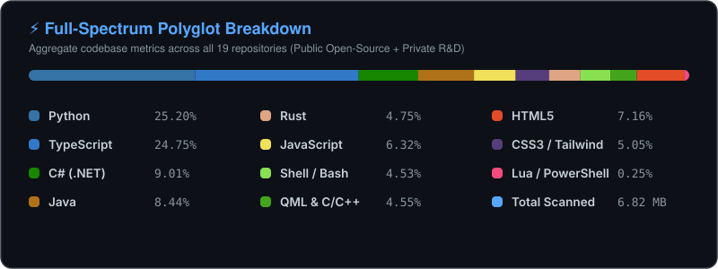

<div align="center">

  <!-- ==================== DYNAMIC HEADER BANNER ==================== -->
  

  <!-- ==================== ANIMATED TYPING SVG ==================== -->
  <a href="https://github.com/Yahia-Elhamzawy">
    
  </a>

  <!-- ==================== QUICK BADGE MATRIX ==================== -->
  <p align="center">
    <a href="https://github.com/Yahia-Elhamzawy">
      
    </a>
    
    
    
  </p>

</div>

---

### 🖥️ `whoami` & Terminal Bio

```yaml
╭──────────────────────────────── Yahia-Elhamzawy@Terminal ────────────────────────────────╮
│                                                                                          │
│  🧑‍💻 Identity   : Yoha El Hamzawy (Yahia)                                               │
│  🚀 Archetype  : Full-Spectrum Systems, Embedded Robotics & Autonomous AI Architect      │
│  🦀 Core Stack : Rust, Linux Kernel, Python, Java (Spring Boot), TypeScript, C#, C/C++  │
│  🤖 AI Engine  : Google Gemini (Multimodal 3.5 & 3.8 TTS), Groq LPU, Vector Embeddings  │
│  🚗 Hardware   : ESP32-S3, Computer Vision Sensor Loops, Microcontroller Firmware       │
│  🎯 Philosophy : "Engineering zero-compromise, fail-safe intelligence from silicon to UI"│
│  📩 Contact    : yahya.elhamzawy.me@gmail.com                                            │
│                                                                                          │
╰──────────────────────────────────────────────────────────────────────────────────────────╯
```

---

### 🔒 Proprietary & Closed-Source R&D Showcase

> [!NOTE]
> **Confidential Architecture & Core Team Inquiries:**  
> The repositories below represent flagship proprietary systems, custom operating environments, and autonomous hardware-software platforms.  
> 🤝 **If you represent a venture team, technical leadership, or wish to audit codebases / join the development team**, request private access directly via email: **[`yahya.elhamzawy.me@gmail.com`](mailto:yahya.elhamzawy.me@gmail.com)**.

<table>
  <tr>
    <td width="33%" valign="top">
      <h3 align="center">💎 <a href="https://github.com/Yahia-Elhamzawy/LaraOS">LaraOS V1 Beta</a></h3>
      <p align="center">
        
        
        
      </p>
      <p><b>The Premier AI-Native Hybrid Linux Operating System.</b> Engineered on Ubuntu 24.04 Noble with a high-performance Rust core, custom GRUB ISO installer, Google Material 3 UI, and native GenAI CLI engine.</p>
      <ul>
        <li>🦀 Pure Rust system daemon & process coordinator</li>
        <li>💿 Custom ISO distribution & GRUB packaging toolchain</li>
        <li>🤖 Native terminal LLM copilot integrated into shell</li>
      </ul>
      <p align="center">
        <a href="mailto:yahya.elhamzawy.me@gmail.com?subject=Access%20Request:%20LaraOS%20Codebase">
          
        </a>
      </p>
    </td>
    <td width="33%" valign="top">
      <h3 align="center">🚗 <a href="https://github.com/Yahia-Elhamzawy/RCS">RCS (Robotic Car System)</a></h3>
      <p align="center">
        
        
        
      </p>
      <p><b>Voice-Guided Autonomous Micro-Vehicle & Edge Vision Loop.</b> Bridges hardware microcontrollers with cloud multimodal AI for camera perception, ambient sensory feedback, and real-time navigation.</p>
      <ul>
        <li>📡 ESP32-S3 microcontroller real-time motor controller</li>
        <li>📷 Multimodal camera feed evaluation via Gemini 3.5</li>
        <li>🎙️ Voice-directed navigation & sensory telemetry</li>
      </ul>
      <p align="center">
        <a href="mailto:yahya.elhamzawy.me@gmail.com?subject=Access%20Request:%20RCS%20Robotics%20Codebase">
          
        </a>
      </p>
    </td>
    <td width="33%" valign="top">
      <h3 align="center">🏛️ <a href="https://github.com/Yahia-Elhamzawy/ICT_Connectors">ICT Connectors</a></h3>
      <p align="center">
        
        
        
      </p>
      <p><b>Enterprise Academic Collaboration & Resource Ecosystem.</b> Heavy-duty infrastructure built with Java Spring Boot, microservices architecture, Next.js interface, and production multi-container Docker fleets.</p>
      <ul>
        <li>☕ Robust Java & Spring Boot backend services</li>
        <li>🎭 Playwright automated end-to-end testing matrix</li>
        <li>🐳 Multi-environment Docker Compose production fleet</li>
      </ul>
      <p align="center">
        <a href="mailto:yahya.elhamzawy.me@gmail.com?subject=Access%20Request:%20ICT%20Connectors%20Codebase">
          
        </a>
      </p>
    </td>
  </tr>
</table>

---

### 🌟 Open-Source & Public Flagships

<table>
  <tr>
    <td width="50%" valign="top">
      <h3 align="center">🎙️ <a href="https://github.com/Yahia-Elhamzawy/gemini-voice-ai">Gemini Voice AI</a></h3>
      <p align="center">
        
        
        
      </p>
      <p><b>Next-Gen Conversational Companion</b> featuring a real-time reactive 3D audio orb, sub-second latency duplex audio streaming, and expressive voice synthesis powered by Gemini 3.8 Flash TTS.</p>
      <ul>
        <li>✨ 3D Audio-reactive particle orb rendered in WebGL</li>
        <li>⚡ Real-time bidirectional streaming over WebSockets</li>
        <li>🎨 Dynamic visual state reactions to ambient voice tones</li>
      </ul>
    </td>
    <td width="50%" valign="top">
      <h3 align="center">🤖 <a href="https://github.com/Yahia-Elhamzawy/AssisSSH">AssisSSH</a></h3>
      <p align="center">
        
        
        
      </p>
      <p><b>Autonomous Linux & DevOps AI Agent</b> designed for zero-interruption fleet monitoring, automatic failover between LLM providers, and remote infrastructure administration.</p>
      <ul>
        <li>🛡️ Zero-downtime automated failover (Gemini ➔ Groq LPU)</li>
        <li>💻 Full-fidelity embedded web SSH terminal & session memory</li>
        <li>🤖 Telegram bot interface for instant on-the-go server control</li>
      </ul>
    </td>
  </tr>
  <tr>
    <td width="50%" valign="top">
      <h3 align="center">🧠 <a href="https://github.com/Yahia-Elhamzawy/EyraOS">EyraOS</a></h3>
      <p align="center">
        
        
        
      </p>
      <p><b>Cognitive Architecture & Agent OS</b> powering graph-based knowledge association, long-term semantic vectorized memory recall, and real-time visual neural mapping.</p>
      <ul>
        <li>🕸️ Interactive real-time cognitive graph visualization</li>
        <li>💾 Hybrid search combining relational schema + pgvector</li>
        <li>⚡ Fast multi-turn contextual memory synthesis</li>
      </ul>
    </td>
    <td width="50%" valign="top">
      <h3 align="center">🛡️ <a href="https://github.com/Yahia-Elhamzawy/Encrypto">Encrypto & Security Ops</a></h3>
      <p align="center">
        
        
        
      </p>
      <p><b>Suite of Defensive Tools & Automations</b> encompassing robust cryptographic utilities, RTL terminal rendering for Arabic/Persian shell environments, and automation bots.</p>
      <ul>
        <li>🔒 Client-side end-to-end cryptographic safeguards</li>
        <li>🖥️ RTL terminal emulator with Unicode, ANSI & font customization</li>
        <li>⚡ Micro-service bot scripts for automated repetitive tasks</li>
      </ul>
    </td>
  </tr>
</table>

---

### 💻 Full-Spectrum Polyglot Matrix (All 19 Repositories)

<div align="center">
  <p>True aggregate codebase metrics across all 19 repositories (Open-Source + Private R&D Infrastructure):</p>
  
</div>

---

### 🛠️ Tech Arsenal & Weaponry

<div align="center">

#### 🦀 Systems, Kernels & Hardware
<p>
  
  
  
  
  
</p>

#### 🧠 Machine Intelligence & Multimodal AI
<p>
  
  
  
  
  
</p>

#### ⚡ Enterprise Backends & Distributed Architecture
<p>
  
  
  
  
  
  
  
  
</p>

#### ☁️ DevOps, Cloud & Testing Excellence
<p>
  
  
  
  
  
</p>

#### 🎨 Modern Frontend, UI Systems & 3D
<p>
  
  
  
  
  
  
</p>

</div>

---

### 🐍 Contribution Activity Matrix (Nokia 3310 Retro Snake)

<div align="center">
  <picture>
    <source media="(prefers-color-scheme: dark)" srcset="https://raw.githubusercontent.com/Yahia-Elhamzawy/Yahia-Elhamzawy/output/github-contribution-grid-snake-dark.svg" />
    <source media="(prefers-color-scheme: light)" srcset="https://raw.githubusercontent.com/Yahia-Elhamzawy/Yahia-Elhamzawy/output/github-contribution-grid-snake.svg" />
    
  </picture>
</div>

---

### 📡 Initiate Uplink (Let's Connect & Collaborate)

<div align="center">
  <p>I am actively welcoming technical inquiries for <b>Systems Architecture</b>, <b>Autonomous Multimodal Robotics</b>, and <b>Core Engineering Teams</b>.</p>

  <p>
    <a href="mailto:yahya.elhamzawy.me@gmail.com">
      
    </a>
  </p>
  <p>
    <a href="https://github.com/Yahia-Elhamzawy">
      
    </a>
    <a href="https://t.me/Yahia_Elhamzawy">
      
    </a>
    <a href="https://linkedin.com/in/yahia-elhamzawy">
      
    </a>
  </p>
  
  <br />

  <!-- ==================== WAVING FOOTER ==================== -->
  
</div>
